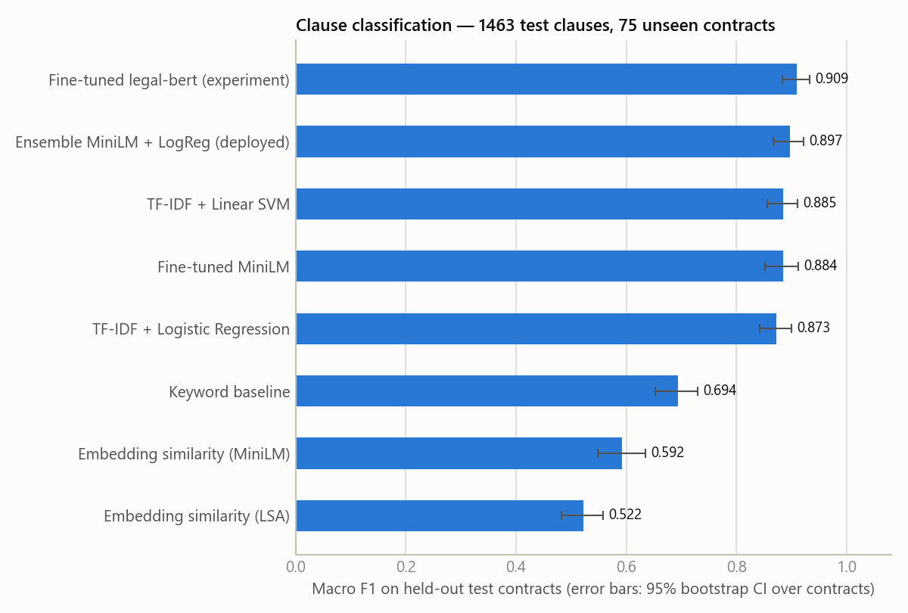
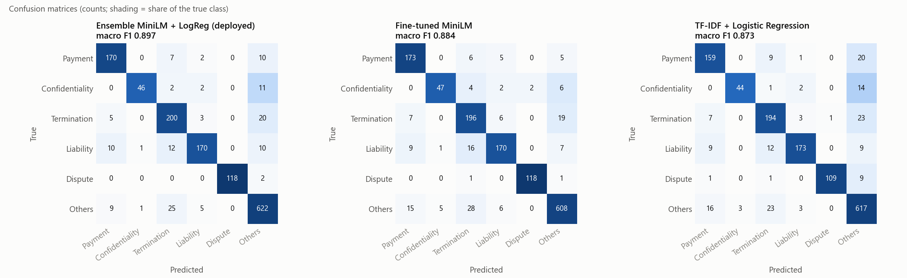
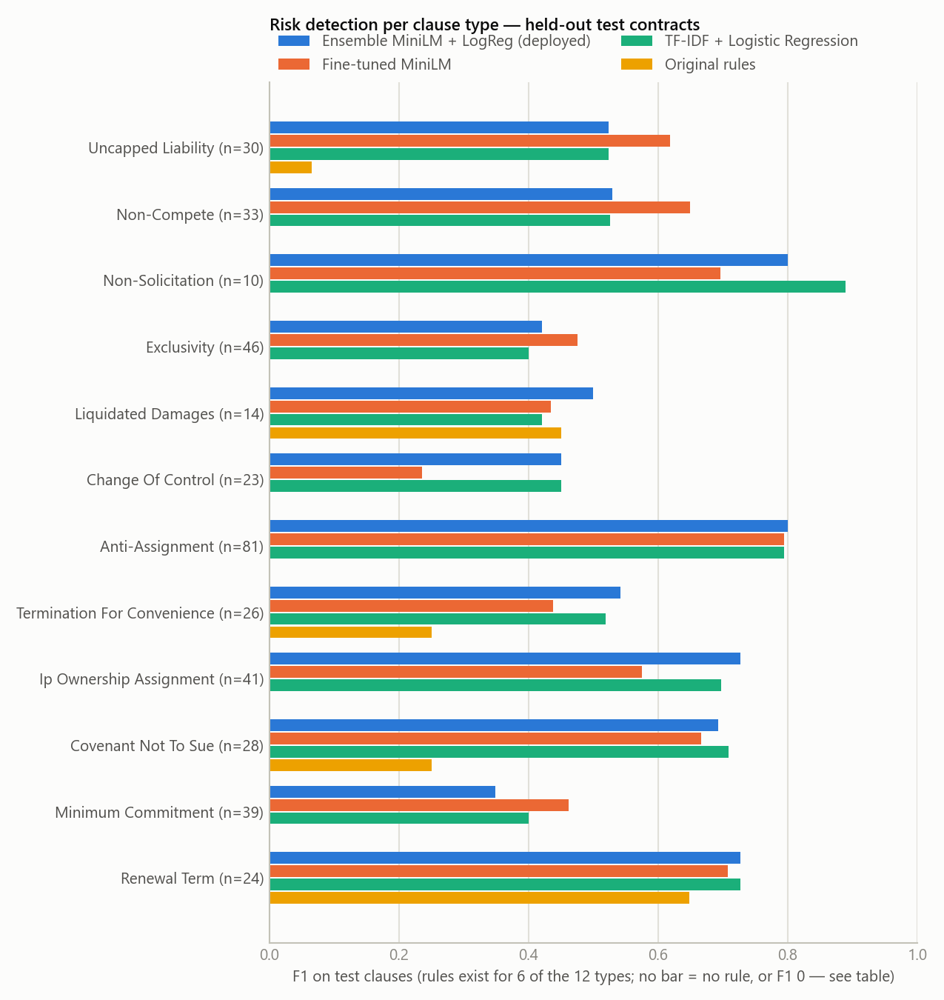
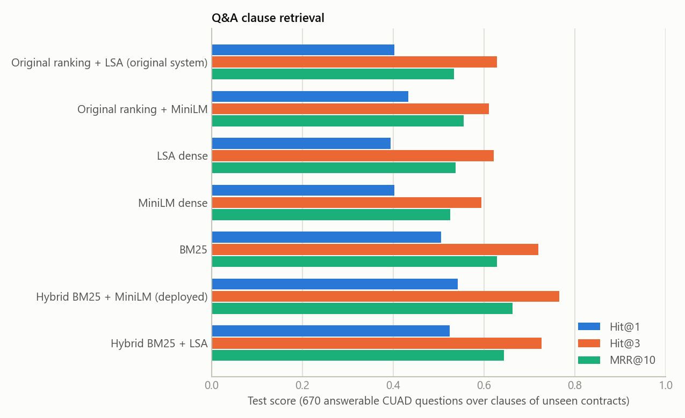

# Evaluation, results and limitations

All numbers below were produced on this machine by the scripts in this repository (Windows 11, Python 3.12, torch 2.13
+ CUDA 12.6 on an NVIDIA GTX 1650 4 GB; 12-thread Intel CPU). The complete, auto-generated report with every table and
figure is [`reports/evaluation/RESULTS.md`](../reports/evaluation/RESULTS.md) (`reports/evaluation/metrics.json` holds the
raw numbers). Nothing here was estimated or copied from elsewhere.

## How the upgraded models were evaluated

* **Data.** CUAD v1 only (510 real contracts, expert annotations, CC BY 4.0) — see [DATASETS.md](DATASETS.md).
  Contracts are grouped by filing company and the groups split 70/15/15 into **train / validation / test**
  (351 / 80 / 79 contracts, seed 42). No test contract — and no sibling exhibit of a test contract — is seen during
  training; identical texts are removed across splits.
* **Selection only on validation.** Best epoch, risk thresholds, ensemble weights, Q&A fusion settings and the
  "not found" threshold were all chosen on the validation contracts. The test contracts were scored once, at the end,
  by `scripts/evaluate_models.py`.
* **Same data for every method.** All classical baselines were retrained on the same training contracts, so every row
  of every table is directly comparable.
* **Uncertainty.** 95% confidence intervals come from a cluster bootstrap over test *contracts* (1,000 resamples),
  because clauses of one contract are not independent. Paired bootstraps test the difference between two models on the
  same resamples.
* **Reproducibility.** Seeds are fixed and Transformer training uses deterministic attention kernels; two identical
  runs produced byte-identical weights (checked). The Legal-BERT experiment was interrupted by the PC sleeping and
  resumed from its epoch-2 checkpoint (optimizer, scheduler and random-number state restored).

### Why the old 0.878 cannot be compared with the new numbers

The original TF-IDF + Logistic Regression scored macro F1 **0.878** on a test set drawn **at random by clause** from a
dataset that also contained 131 project-written clauses; clauses of the same contract were in both train and test,
which inflates scores. The sandbox Transformer's **0.864** was a *validation* score on yet another split. Neither
number is comparable with anything below. The fair comparison is the table in section 1, where every method — including
Logistic Regression, retrained — is trained on the same training contracts and scored on the same unseen test contracts.

## 1. Clause classification (6 categories)

1,463 test clauses from 75 of the 79 test contracts (4 contracts contribute no example after deduplication);
1,121 carry expert labels ("gold"), the rest heading-derived labels.



| Method | Val macro F1 | Test accuracy | **Test macro F1** [95% CI] | Gold macro F1 | ROC-AUC |
|---|---|---|---|---|---|
| Fine-tuned Legal-BERT (experiment, not deployed) | 0.918 | 0.917 | **0.909** [0.883, 0.932] | 0.922 | 0.987 |
| Ensemble: MiniLM × 0.3 + LogReg × 0.7 (legacy, rollback via `CLASSIFIER_BACKEND=auto`) | 0.899 | 0.906 | **0.897** [0.867, 0.922] | 0.910 | 0.982 |
| TF-IDF + Linear SVM | 0.886 | 0.895 | **0.885** [0.856, 0.911] | 0.898 | 0.976 |
| **Fine-tuned MiniLM alone (deployed)** | 0.870 | 0.897 | **0.884** [0.852, 0.912] | 0.894 | 0.980 |
| TF-IDF + Logistic Regression (fallback) | 0.878 | 0.886 | **0.873** [0.842, 0.900] | 0.893 | 0.977 |
| Keyword baseline | 0.661 | 0.658 | **0.694** [0.652, 0.729] | 0.640 | – |
| Embedding similarity (MiniLM) | – | 0.614 | **0.592** [0.548, 0.635] | 0.527 | 0.800 |
| Embedding similarity (LSA) | – | 0.495 | **0.522** [0.482, 0.557] | 0.450 | 0.812 |

Paired bootstrap over test contracts (macro F1 difference, 95% CI):
ensemble − Logistic Regression **+0.024 [+0.008, +0.041]** (better in every resample);
MiniLM − Logistic Regression +0.011 [−0.013, +0.034]; ensemble − MiniLM +0.013 [−0.002, +0.031];
ensemble − SVM +0.012 [−0.001, +0.023].

What this shows:
* The fine-tuned **MiniLM on its own is not clearly better** than TF-IDF models (inside the noise; worse on validation).
* The **deployed model is the fine-tuned MiniLM alone** (a Transformer with a trainable classification head, no
  classical classifier in the prediction path; Logistic Regression is loaded only if the Transformer cannot be).
  This trades about 1.3 points of macro F1 against the earlier ensemble (CI includes 0) for a single, simpler model.
* The **ensemble chosen on validation is clearly better than Logistic Regression** (+2.4 points macro F1) and remains
  available as the legacy configuration. The confusion matrices show why it worked: MiniLM rarely pushes Payment, Confidentiality and
  Dispute clauses into "Others" (Logistic Regression does so 20, 14 and 9 times), while Logistic Regression confuses
  fewer "Others" clauses with Termination — different mistakes average out.
* **Legal-BERT is the most accurate model** (validation and test agree), see the trade-off below.
* Out-of-domain sanity check on the 31 hand-labelled clauses of the project's Indian reference templates (accuracy):
  ensemble 0.935, MiniLM 0.903, Logistic Regression 0.968, keyword baseline 0.903 — n is tiny (one clause ≈ 0.03).



### Legal-BERT: why it is not deployed (yet)

| | Legacy ensemble (MiniLM + LogReg) | Legal-BERT (`nlpaueb/legal-bert-base-uncased`) |
|---|---|---|
| Validation / test macro F1 | 0.899 / 0.897 | **0.918 / 0.909** |
| Parameters / model file | 22.7 M / 45 MB (+3 MB LogReg) | 109.5 M / 219 MB |
| Inference, CPU (12 threads) | 48 ms per clause | 339 ms per clause (≈ 7×) |
| Inference, GTX 1650 | 2.6 ms per clause | 20.7 ms per clause |
| Training on the GTX 1650 | 12 min (5 epochs) | ≈ 19 min per epoch (4 epochs) |
| Licence of the base model | Apache 2.0 | CC BY-SA 4.0 (fine-tuned weights must be shared alike) |

Legal-BERT gains about 1–2 points of macro F1, at 5× the size and 7× the CPU time (a 100-clause contract: ~5 s vs
~34 s of classification on CPU). The app keeps the lighter MiniLM; switching is one retraining command:

```bash
python scripts/train_transformer.py --task clause --model nlpaueb/legal-bert-base-uncased --lr 3e-5 --epochs 4 --batch-size 8 --grad-accum 4
python scripts/fit_ensembles.py && python scripts/evaluate_models.py
```

## 2. Risk detection (12 CUAD clause types, multi-label)

4,034 test clauses of 79 contracts at their natural balance (347 with at least one risk type); per-type thresholds
tuned on validation.



| Method | Micro P | Micro R | **Micro F1** [95% CI] | Macro F1 | Macro ROC-AUC | Macro avg. precision |
|---|---|---|---|---|---|---|
| Ensemble MiniLM × 0.2 + TF-IDF × 0.8 (legacy, rollback via `RISK_MODEL=auto`) | 0.554 | 0.613 | **0.582** [0.543, 0.623] | 0.588 | **0.985** | **0.683** |
| **Fine-tuned MiniLM alone (deployed)** | 0.605 | 0.592 | **0.599** [0.559, 0.636] | 0.563 | 0.967 | 0.565 |
| TF-IDF + Logistic Regression (one-vs-rest) | 0.572 | 0.592 | **0.582** [0.543, 0.618] | 0.588 | 0.983 | 0.664 |

On the 6 types that one of the original rules targets: original rules micro F1 **0.164** (P 0.119, R 0.265) vs
**0.603** for the deployed MiniLM detector (0.592 for the legacy ensemble); 6 types have no rule at all (exclusivity, change of control, anti-assignment,
IP ownership assignment, minimum commitment, non-solicitation).

What this shows: every learned detector is far better than the hand-written rules at recognising CUAD's risk-relevant
clause types (expected — the rules target Indian consumer contracts). Between the learned detectors, micro-F1
differences are inside the noise (paired 95% CIs include 0); the legacy ensemble has the best ranking quality (macro
average precision 0.683); the fine-tuned MiniLM alone is deployed (highest micro F1, lower macro F1 and ranking quality). Per-type F1 ranges from 0.38 (Minimum Commitment) to 0.80
(Anti-Assignment, Non-Solicitation); types with 10–14 test positives are noisy.

## 3. Q&A retrieval

2,844 test questions over the segmented clauses of 79 unseen contracts (36 CUAD questions per contract); 670
answerable questions with a located answer clause are used for ranking.



| Ranker | Test Hit@1 | Test Hit@3 | **Test MRR@10** [95% CI] | nDCG@5 |
|---|---|---|---|---|
| Original ranking + LSA (the original system) | 0.403 | 0.619 | **0.534** [0.498, 0.574] | 0.538 |
| Original ranking + MiniLM | 0.427 | 0.606 | **0.551** [0.515, 0.589] | 0.544 |
| LSA dense | 0.394 | 0.621 | **0.537** [0.498, 0.577] | 0.539 |
| MiniLM dense | 0.403 | 0.594 | **0.525** [0.491, 0.561] | 0.511 |
| BM25 | 0.506 | 0.719 | **0.628** [0.599, 0.661] | 0.621 |
| **Hybrid BM25 + MiniLM (deployed)** | **0.539** | **0.772** | **0.666** [0.637, 0.696] | **0.656** |
| Hybrid BM25 + LSA | 0.530 | 0.736 | **0.648** [0.614, 0.684] | 0.640 |

Settings chosen on validation: weighted fusion of min-max-normalised scores, dense weight 0.5, category-intent boost 0.1.
Hybrid retrieval improves MRR@10 from 0.534 to 0.666 (+0.13) and Hit@3 from 0.62 to 0.77. Interesting detail: on
these long contracts MiniLM alone is *not* better than LSA or BM25 — it is the combination that helps.

**"Not found" answers** (unanswerable = the clause type does not occur in that contract):

| System | Says "not found" when unanswerable | Answers when answerable | Balanced accuracy | End-to-end correct |
|---|---|---|---|---|
| Original ranking (LSA) | 0.032 | 1.000 | 0.516 | 0.172 |
| Hybrid + calibrated answerability (deployed) | **0.410** | 0.904 | **0.657** | **0.485** |

The original system almost never says "not found" (3%), so for unanswerable questions it quotes unrelated clauses.
The deployed logistic answerability model (top cosine, top BM25 per query term, query-term coverage; ROC-AUC 0.789 on
test) was set to keep answering ≥ 90% of answerable validation questions. End-to-end correct = "not found" for
unanswerable questions, a relevant clause in the top 3 for answerable ones.

## 4. Extractive key sentences

Not scored (there are no reference summaries for these contracts). Tests check that every key sentence is quoted
verbatim from a non-preamble clause and returned in document order.

## 5. Sample documents: fallback vs upgraded configuration

`scripts/compare_sample_documents.py` analyses every raw document twice (full table in
[RESULTS.md](../reports/evaluation/RESULTS.md)):

* **Synthetic Indian samples: unchanged risk profiles** — e.g. the balanced lease and offer letter still have
  0 HIGH / 0 MEDIUM clauses; the one-sided employment agreement keeps 6 HIGH / 2 MEDIUM. The detector adds evidence
  (e.g. *Non-Compete*, *Termination For Convenience*) to clauses the rules already flagged, and only informational
  (LOW) items to the balanced documents.
* **Real CUAD contracts: new MEDIUM flags** for clause types the rules never covered — e.g. the endorsement agreement
  goes from 0 to 5 MEDIUM (exclusivity, minimum commitment, non-compete), the distributor agreement from 2 to 6.
* One contract's HIGH count fell from 2 to 1. Not the detector (it can never lower a level): the Logistic Regression
  classifier had labelled a payment-notice clause ("…notify THI … sixty (60) days before the IP Cost is due") as
  *Termination*, which wrongly fired the short-notice rule; the ensemble correctly labels it *Payment*.

## Automated tests

`python -m pytest backend/tests` — **88 passed, 2 skipped** (the 2 OCR tests: Tesseract is not installed here), in
about 50 s on the GPU machine. The same 88 pass with the LSA embedding fallback (`EMBEDDING_BACKEND=lsa`). Before the
upgrade, the unchanged code on this machine gave 64 passed, 1 failed, 2 skipped: the comparison test failed because
sentence-transformers was installed, so MiniLM embeddings were used with a similarity cut-off tuned for LSA (now
per-backend).

New tests (23): `test_transformer_models.py` (models load with the expected labels, valid probabilities, ensemble
weights from validation, save/load round trip in float16, missing model → Logistic Regression, disabled by
configuration, inference failure → fallback, risk-merge policy incl. mutual wording and "never lowers a rule level"),
`test_retrieval.py` (tokenizer, BM25 edge cases, fusion, legacy mode, calibrated and uncalibrated "not found", the
notice-period / pet-ownership questions on the sample agreement, extractive summary), and in `test_api.py` empty and
unreadable files, unsupported formats, model information and key sentences in the analysis, a full analysis without
the Transformer models, and rules-only mode.

## Limitations (please state these in the report/viva)

1. **The Transformer alone is not better than TF-IDF on clause classification.** On validation the fine-tuned MiniLM
   (0.870 macro F1) is slightly *below* Logistic Regression (0.878) and the linear SVM (0.886); on test it is slightly
   above Logistic Regression, but the difference is inside the bootstrap noise. CUAD clause types have strong lexical
   cues, which TF-IDF captures well. The models make *different* mistakes, so their probability average is what the app
   deploys (chosen on validation).
2. **Domain shift.** All learned models are trained on US commercial contracts (CUAD). The app's sample documents and
   reference templates are Indian employment, rental, NDA and service agreements. Accuracy on the 31 hand-labelled
   reference-template clauses is reported in section 1 — n is tiny, so treat it as a sanity check only.
3. **Risk labels are CUAD clause types, not risk judgements.** The detector recognises *kinds* of clauses that reviewers
   flag (uncapped liability, non-compete, exclusivity…); the level shown to the user comes from a documented policy
   (`MODEL_RISK_POLICY`), not from the data. Known failure: negation — "This License does **not** include a minimum
   annual royalty" was flagged as *Minimum Commitment* in a CUAD sample contract. Rare types have 10–14 test
   positives, so their per-type scores are noisy.
4. **The original rules were written for Indian consumer/employment contracts**, so their low recall on CUAD types
   is expected; the comparison shows what the learned detector adds, not that the rules are wrong for their purpose.
5. **"Not found" is calibrated on CUAD's questions**, which are long and formulaic; users ask short questions. The
   operating point favours answering (≥ 90% of answerable validation questions are answered), and documents with
   fewer than 5 clauses use the original overlap rule. On the project's sample documents 20 questions with an obvious
   expected outcome were checked by hand: 18 behaved as expected. The two misses show the trade-off — "How long does
   confidentiality last?" got "not found" although the NDA says the obligations "continue indefinitely" (no shared
   words), and "Can I work from home?" was answered with the Working Hours clause although the document says nothing
   about working from home.
6. **No summary quality score.** There are no reference summaries for these contracts, so the extractive key sentences
   cannot be scored with ROUGE; they are quoted verbatim (nothing is generated) and shown with links to their clauses.
7. **No LLM was used in testing.** Generation via Anthropic / OpenAI-compatible / Ollama is implemented and tested with
   mocked HTTP responses only; output quality with a real model has not been measured.
8. **Legal-BERT** was trained as an experiment only (see section 1); it is not deployed — see the trade-off below.
9. **Tesseract OCR is not installed on the evaluation machine**, so the two OCR tests are skipped; OCR was verified in
   the original build environment.
10. **Risk rules are tuned to Indian consumer/employment contexts** (e.g. Model Tenancy Act deposit benchmark,
    s. 27 ICA non-competes). They flag *potential* risks for review, not legality. The knowledge base has 15
    educational summaries and does not cover all of Indian law.
11. **Document-type detection** uses keyword profiles over four types; CUAD's US commercial contracts are mostly
    detected as "service". Users can select the type at upload to override it.
12. **Clause segmentation** relies on headings/numbering; documents without structure fall back to paragraphs.
13. **PostgreSQL and Redis** are supported through SQLAlchemy/redis-py but were not used in testing; SQLite and the
    memory+disk cache were.

## Original version (kept for reference)

Results of the first version, measured on the original random clause-level split (4,135 clauses incl. 131
project-written; test 827, gold subset 646). **Not comparable** with the tables above (see the note at the top).

| Method | Accuracy | Macro F1 | Gold accuracy | Gold macro F1 |
|---|---|---|---|---|
| Keyword baseline | 0.658 | 0.699 | 0.605 | 0.604 |
| Embedding similarity (LSA embeddings) | 0.498 | 0.534 | 0.433 | 0.415 |
| TF-IDF + Logistic Regression (deployed then) | 0.877 | 0.878 | 0.882 | 0.812 |
| TF-IDF + Linear SVM | 0.886 | 0.886 | 0.896 | 0.827 |
