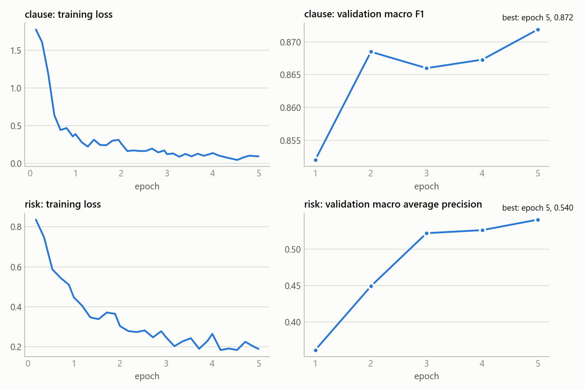

# LegalLens evaluation results

Generated by `scripts/evaluate_models.py` on 2026-09-30T19:05:12+00:00 (1000 bootstrap resamples). Every number is measured on the **held-out test contracts**; model selection, thresholds and retrieval settings used only the training and validation contracts.

## Data

CUAD v1 (CC BY 4.0, sha256 `ed0b77d85bdf4014…`), split by filing company, stratified by contract type, seed 42.

| | Train | Validation | Test |
|---|---|---|---|
| Contracts | 351 | 80 | 79 |
| Clause-classification examples | 5933 | 1514 | 1463 |
| … of which expert (gold) labels | 4886 | 1158 | 1121 |
| Risk-detection clauses (with ≥1 risk label) | 4449 (1483) | 4327 (326) | 4034 (347) |

## 1. Clause classification

| Method | Val macro F1 | Test accuracy [95% CI] | Macro P | Macro R | Test macro F1 [95% CI] | Weighted F1 | ROC-AUC (macro OvR) | Gold acc. | Gold macro F1 |
|---|---|---|---|---|---|---|---|---|---|
| TF-IDF + Linear SVM | 0.886 | 0.895 [0.866, 0.923] | 0.915 | 0.863 | **0.885** [0.856, 0.911] | 0.895 | 0.976 | 0.914 | 0.898 |
| Fine-tuned MiniLM (deployed) | 0.870 | 0.897 [0.867, 0.923] | 0.890 | 0.881 | **0.884** [0.852, 0.912] | 0.897 | 0.980 | 0.906 | 0.894 |
| TF-IDF + Logistic Regression | 0.878 | 0.886 [0.859, 0.910] | 0.901 | 0.851 | **0.873** [0.842, 0.900] | 0.886 | 0.977 | 0.907 | 0.893 |
| Keyword baseline | 0.661 | 0.658 [0.617, 0.697] | 0.692 | 0.741 | **0.694** [0.652, 0.729] | 0.667 | – | 0.608 | 0.640 |
| Embedding similarity (MiniLM) | – | 0.614 [0.584, 0.644] | 0.599 | 0.632 | **0.592** [0.548, 0.635] | 0.613 | 0.800 | 0.570 | 0.527 |
| Embedding similarity (LSA) | – | 0.495 [0.457, 0.535] | 0.487 | 0.652 | **0.522** [0.482, 0.557] | 0.467 | 0.812 | 0.418 | 0.450 |

Gold macro F1 averages over the five classes present in the expert-labelled subset (CUAD has no confidentiality label, so that class exists only among heading-derived labels).

Paired bootstrap (transformer_minilm - tfidf_logreg (macro F1, all test clauses)): observed difference +0.011, 95% CI [-0.013, 0.034]; share of resamples where the Transformer is not better: 0.172.

Test: 1463 clauses from 75 contracts (1121 with expert labels; the rest are heading-derived weak labels). Gold = expert-labelled subset.

Per-class F1 (all test clauses):

| Class | Fine-tuned MiniLM (deployed) | TF-IDF + Logistic Regression | Support |
|---|---|---|---|
| Payment | 0.880 | 0.835 | 189 |
| Confidentiality | 0.825 | 0.815 | 61 |
| Termination | 0.818 | 0.829 | 228 |
| Liability | 0.867 | 0.899 | 203 |
| Dispute | 0.983 | 0.948 | 120 |
| Others | 0.930 | 0.911 | 662 |

Out-of-domain check — the project's Indian reference templates (31 hand-annotated clauses; accuracy): Fine-tuned MiniLM (deployed) 0.903, TF-IDF + Logistic Regression 0.968, Keyword baseline 0.903.

## 2. Risk detection (12 CUAD clause types, multi-label)

| Method | Micro P | Micro R | Micro F1 [95% CI] | Macro F1 | Macro ROC-AUC | Macro avg. precision | Any-risk clause F1 |
|---|---|---|---|---|---|---|---|
| Fine-tuned MiniLM (deployed) | 0.605 | 0.592 | **0.599** [0.559, 0.636] | 0.563 | 0.967 | 0.565 | 0.651 |
| TF-IDF + Logistic Regression | 0.573 | 0.598 | **0.585** [0.546, 0.621] | 0.591 | 0.983 | 0.661 | 0.658 |

Paired bootstrap (transformer_minilm - tfidf_logreg_ovr (micro F1)): +0.014, 95% CI [-0.028, 0.056].

Test: 4034 clauses of 79 contracts, 347 with at least one risk label (natural distribution). Thresholds per type were tuned on validation.

| Risk type | Support | MiniLM P | MiniLM R | MiniLM F1 | MiniLM AUC | LogReg F1 | Rules F1 |
|---|---|---|---|---|---|---|---|
| Uncapped Liability | 30 | 0.680 | 0.567 | 0.618 | 0.948 | 0.524 | 0.065 |
| Non-Compete | 33 | 0.568 | 0.758 | 0.649 | 0.990 | 0.526 | 0.000 |
| Non-Solicitation | 10 | 0.615 | 0.800 | 0.696 | 0.973 | 0.889 | no rule |
| Exclusivity | 46 | 0.559 | 0.413 | 0.475 | 0.975 | 0.400 | no rule |
| Liquidated Damages | 14 | 0.556 | 0.357 | 0.435 | 0.979 | 0.421 | 0.450 |
| Change Of Control | 23 | 0.364 | 0.174 | 0.235 | 0.970 | 0.450 | no rule |
| Anti-Assignment | 81 | 0.857 | 0.741 | 0.795 | 0.976 | 0.794 | no rule |
| Termination For Convenience | 26 | 0.368 | 0.538 | 0.438 | 0.950 | 0.552 | 0.250 |
| Ip Ownership Assignment | 41 | 0.509 | 0.658 | 0.575 | 0.943 | 0.698 | no rule |
| Covenant Not To Sue | 28 | 0.739 | 0.607 | 0.667 | 0.930 | 0.708 | 0.250 |
| Minimum Commitment | 39 | 0.577 | 0.385 | 0.462 | 0.971 | 0.403 | no rule |
| Renewal Term | 24 | 0.561 | 0.958 | 0.708 | 0.995 | 0.727 | 0.649 |

On the 6 types that an original rule targets (Uncapped Liability, Non-Compete, Liquidated Damages, Termination For Convenience, Covenant Not To Sue, Renewal Term):

| Method | Micro P | Micro R | Micro F1 |
|---|---|---|---|
| Original rules | 0.119 | 0.265 | 0.164 |
| Fine-tuned MiniLM (deployed) | 0.561 | 0.652 | 0.603 |
| TF-IDF + Logistic Regression | 0.615 | 0.568 | 0.591 |

## 3. Q&A retrieval

| Ranker | Val MRR@10 | Test Hit@1 | Test Hit@3 | Test Hit@5 | Test MRR@10 [95% CI] | Test nDCG@5 |
|---|---|---|---|---|---|---|
| legacy_lsa (original ranking, LSA) | 0.546 | 0.402 | 0.625 | 0.718 | **0.533** [0.500, 0.571] | 0.538 |
| legacy_minilm (original ranking, MiniLM) | 0.540 | 0.433 | 0.608 | 0.725 | **0.553** [0.518, 0.590] | 0.546 |
| lsa_dense | 0.547 | 0.394 | 0.621 | 0.734 | **0.537** [0.498, 0.577] | 0.539 |
| minilm_dense | 0.514 | 0.403 | 0.594 | 0.682 | **0.525** [0.491, 0.561] | 0.511 |
| bm25 | 0.648 | 0.507 | 0.716 | 0.803 | **0.629** [0.600, 0.661] | 0.621 |
| hybrid_bm25_minilm (deployed) | 0.683 | 0.542 | 0.773 | 0.824 | **0.667** [0.639, 0.697] | 0.658 |
| hybrid_bm25_lsa | 0.658 | 0.531 | 0.734 | 0.813 | **0.649** [0.615, 0.684] | 0.641 |

Selected on validation: fusion `weighted`, dense weight α = 0.5, category boost 0.1. Answerability: logistic regression on (top dense cosine, top BM25 per query term, query-term coverage), threshold 0.22 (validation balanced accuracy 0.725).

"Not found" decision on test questions (unanswerable = the clause type is absent from the contract):

| System | Says "not found" when unanswerable | Answers when answerable | Balanced acc. | Not-found F1 | End-to-end correct |
|---|---|---|---|---|---|
| legacy_lsa (original) | 0.032 | 1.000 | 0.516 | 0.063 | 0.174 |
| legacy_minilm | 0.029 | 1.000 | 0.515 | 0.057 | 0.168 |
| hybrid + uncalibrated rule | 0.032 | 1.000 | 0.516 | 0.063 | 0.209 |
| hybrid + calibrated answerability (deployed) | 0.721 | 0.717 | 0.719 | 0.794 | 0.694 |

ROC-AUC of the calibrated answerability probability on test: 0.790. End-to-end correct = unanswerable questions answered "not found", answerable questions answered with a relevant clause in the top 3.

## 4. Inference speed

| Model | Device | ms per clause |
|---|---|---|
| TF-IDF + Logistic Regression | CPU | 0.38 |
| Fine-tuned MiniLM | NVIDIA GeForce GTX 1650 with Max-Q Design | 3.09 |
| Fine-tuned MiniLM | CPU | 50.72 |

## 5. Training

**clause** — base `sentence-transformers/all-MiniLM-L6-v2`, 5 epochs, lr 5e-05, batch 32, max length 256, seed 42, device cuda; best epoch 5 (selected on validation macro_f1); 742.0 s.

| Epoch | Train loss | Validation |
|---|---|---|
| 1 | 0.8960 | accuracy 0.8593, macro_f1 0.8520 |
| 2 | 0.2705 | accuracy 0.8738, macro_f1 0.8685 |
| 3 | 0.1660 | accuracy 0.8791, macro_f1 0.8660 |
| 4 | 0.1137 | accuracy 0.8824, macro_f1 0.8673 |
| 5 | 0.0807 | accuracy 0.8890, macro_f1 0.8719 |

**risk** — base `sentence-transformers/all-MiniLM-L6-v2`, 5 epochs, lr 5e-05, batch 32, max length 256, seed 42, device cuda; best epoch 5 (selected on validation macro_ap); 1293.4 s.

| Epoch | Train loss | Validation |
|---|---|---|
| 1 | 0.6229 | macro_ap 0.3619, micro_f1 0.2166, macro_f1 0.2119 |
| 2 | 0.3598 | macro_ap 0.4492, micro_f1 0.2560, macro_f1 0.2604 |
| 3 | 0.2682 | macro_ap 0.5217, micro_f1 0.2919, macro_f1 0.2889 |
| 4 | 0.2212 | macro_ap 0.5258, micro_f1 0.3389, macro_f1 0.3354 |
| 5 | 0.1940 | macro_ap 0.5402, micro_f1 0.3441, macro_f1 0.3445 |

